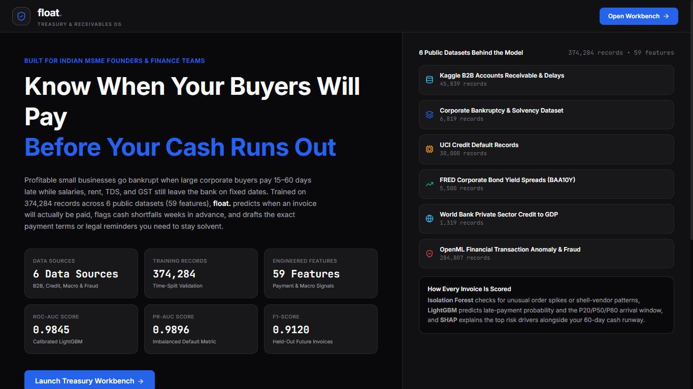
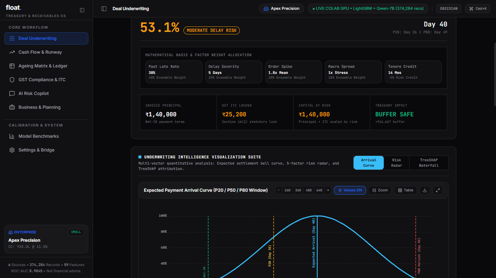
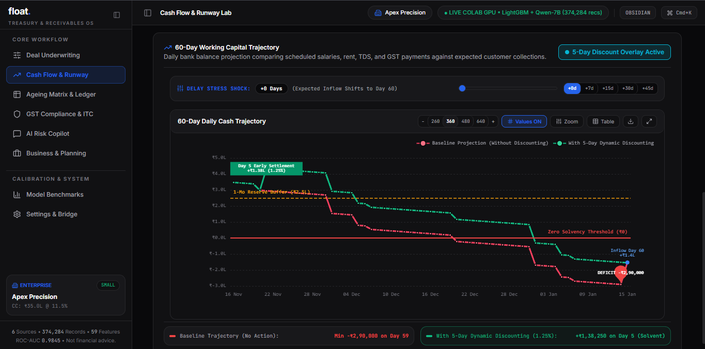
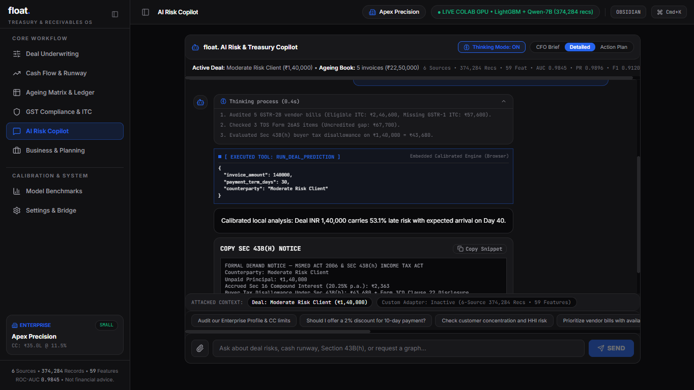
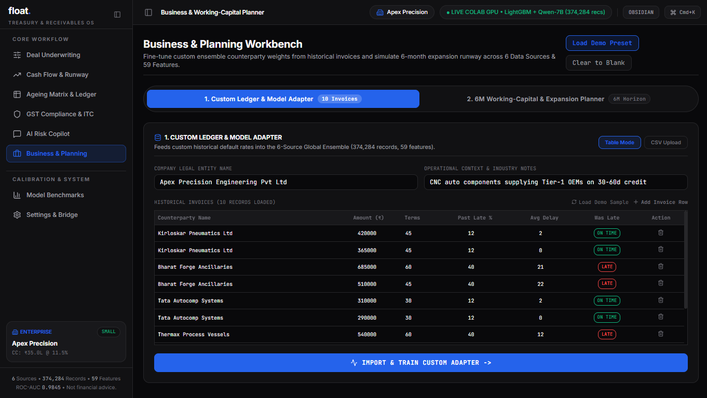

# `float.` - Treasury & Receivables Platform

> **Veritas AI Hackathon 2026, Finance Track Submission.**
> Pre-deal B2B payment delay prediction, 60-day cash-flow runway forecasting, Indian GST and Section 43B(h) statutory compliance, and a guardrailed Qwen-2.5-7B treasury copilot.

## Live Application

**[https://float-workspaces.vercel.app](https://float-workspaces.vercel.app)**

**For judges:** open the live link, go to any workspace screen (Deal Underwriting, Cash Flow & Runway, Ageing Matrix, GST Compliance, Treasury Advisory Copilot, or Business & Planning), and click **Load Demo Preset**. Every screen then populates with a realistic Indian MSME dataset so you can test immediately.

- **Default mode (zero setup):** all pages run on the built-in calibrated browser model, with no backend and no login required.
- **Optional GPU mode:** to run live LightGBM and Qwen-2.5-7B inference, open [`notebooks/float.TM.ipynb`](notebooks/float.TM.ipynb) in Google Colab (T4 GPU), run all cells, and paste the printed `trycloudflare.com` URL into **Settings & Bridge**. If the backend goes offline, `float.` falls back to the browser model automatically.

[](https://colab.research.google.com/github/agnidevaraja/float./blob/main/notebooks/float.TM.ipynb)

---

## 1. The Problem

Thousands of small and mid-sized businesses (MSMEs) in India go bankrupt every year even when their order books are full and their income statements show a profit. The root cause is **working-capital timing mismatch**:

1. **Late Corporate Settlements:** Small manufacturers and suppliers extend Net-30 or Net-45 credit terms to large corporate buyers, but payments routinely arrive 15 to 60+ days late.
2. **Rigid Statutory & Operating Outflows:** While customer cash is delayed, fixed outflows leave the bank on non-negotiable dates every month, **Employee Salaries on the 1st**, **Factory/Office Rent on the 5th**, **TDS Remittance on the 7th**, and **GSTR-3B Tax Payment on the 20th**.
3. **Tax & Overdraft Traps:**
   - Under **Section 16(2) of the CGST Act**, if a supplier is not paid within 180 days, the buyer must reverse their Input Tax Credit (ITC) with **18% p.a. interest**.
   - When a vendor forgets to file **GSTR-1**, the invoice does not appear in **GSTR-2B**, locking up cash on the 20th.
   - To survive a 20-day payment gap before payroll, founders draw down **16%-18% bank overdrafts** or offer arbitrary early-payment discounts without knowing the true annualized cost.

Existing accounting software (Tally, Zoho Books, QuickBooks) only records invoices *after* they are issued and overdue. Founders lack a pre-deal decision system that tells them, **before they sign an order**, when the customer will actually pay, whether that delay will cause a cash shortfall before payroll, and what payment terms or legal remedies protect their cash.

---

## 2. What We Built (`float.`)

**`float.`** (Treasury & Receivables Platform) is an end-to-end B2B credit underwriting, cash-flow runway, and statutory tax compliance workbench built for Indian MSME founders and finance teams. It works **instantly in the browser with zero setup** via our calibrated built-in browser model, and optionally connects to a live **Google Colab T4 GPU backend** ([`notebooks/float.TM.ipynb`](notebooks/float.TM.ipynb)) running our 6-source LightGBM ensemble and 4-bit **Qwen-2.5-7B-Instruct** agent.

### Platform Walkthrough



*Figure 1. Landing page: the six public datasets behind the model, training scale (374,284 records, 59 features), and held-out performance metrics.*

- **Deal Underwriting Workbench:** Before extending credit, founders enter the customer's invoice amount, proposed Net terms, historical late rate, and order size. `float.` returns the calibrated late-payment probability, the **P20 / P50 / P80 cash arrival window** (e.g., *Promised Day 30 &rarr; Expected Day 38, Window Day 35-44*), **SHAP** risk drivers in plain English, **Isolation Forest** anomaly warnings, **TReDS factoring vs. bank overdraft cost comparisons**, and a safer split-milestone counter-offer (e.g., *40% Upfront + 30% Delivery + 30% Net-15*) with a downloadable credit memo.



*Figure 2. Deal Underwriting: late-payment probability, expected arrival day with P20/P80 window, factor weights, GST input tax credit exposure, and the treasury impact verdict.*

- **Cash Flow & Runway Lab (3 Segmented Sub-Workbenches):**
  1. **Trajectory & Collision Lab:** Simulates 60 days of daily bank balances against scheduled payroll (1st), rent (5th), TDS (7th), and GST (20th) across 3 scenarios (*On-Time*, *AI Expected Date*, and *Delinquency Shock*) with an interactive delay stress slider.
  2. **Early-Settlement Discount Solver:** When a pre-payroll cash deficit is detected, the solver calculates the smallest early-payment discount (0.5%-2.5%) to offer a low-risk buyer to settle within 5 days, proving when a 1.0% discount beats an 18% bank overdraft, and drafts the formal settlement memo.
  3. **AP Vendor Dispatch & Commitments:** Prioritizes pending supplier bills using available cash to prevent 180-day GST ITC reversals and Section 43B(h) tax penalties, and benchmarks bank credit limits using the **RBI Nayak Committee (20% turnover MPBF)** rule.



*Figure 3. Cash Flow & Runway Lab: 60-day bank balance projection against payroll, rent, TDS, and GST outflows, with and without an early-settlement discount.*

- **Ageing Matrix, GST Compliance Shield & Treasury Advisory Copilot:**
  - **Ageing Matrix & Ledger:** Organizes open receivables into 5 ageing buckets (`0-30d`, `31-45d`, `46-60d`, `61-90d`, `90d+`), supports drag-and-drop CSV batch scoring, simulates top-buyer default contagion, and generates **MSMED Act Section 15/16 (20.25% interest)** recovery notices.
  - **GST Compliance & Section 16(2) / 43B(h) Shield:** Reconciles vendor invoices against GSTR-2B (with one-click `PAYMENT HELD` controls for non-filing suppliers), tracks the 180-day ITC reversal clock, and computes the **31.2% corporate tax disallowance penalty** that corporate buyers face under **Section 43B(h)** if they delay paying a Micro or Small enterprise past 45 days.
  - **Treasury Advisory Copilot:** Answers plain-English questions about active deals, cash shortfalls, and tax rules using live workspace numbers.



*Figure 4. Treasury Advisory Copilot: tool-calling answers grounded in live workspace numbers, with a ready-to-copy Section 43B(h) demand notice.*

- **Business & Planning Workbench (2 Segmented Sub-Workbenches):**
  1. **Custom Ledger & Model Adapter:** Lets a business upload its own historical invoice CSV (or edit rows inline) to blend company-specific customer payment habits with our 374,284-record global model.
  2. **6M Working-Capital & Expansion Planner:** Simulates 6-month revenue growth, hiring, CapEx equipment purchases, and DSO shifts to flag future working-capital gaps before expansion.



*Figure 5. Business & Planning workbench: custom invoice ledger and model adapter, plus the 6-month working-capital planner.*

---

## 3. How It Works (6-Source ML + Statutory + Agentic Architecture)

All model training, feature engineering, evaluation, red-team verification, and FastAPI serving code is self-contained in [`notebooks/float.TM.ipynb`](notebooks/float.TM.ipynb).

### 3.1 Six Public Datasets (`374,284` Records) & `59` Engineered Features
Rather than relying on a single toy table, we trained a multi-source risk architecture across **6 complementary datasets** totaling **374,284 records** and **59 engineered features**:

| # | Dataset Source | Records | Role in `float.` |
|---|---|---:|---|
| 1 | **Kaggle B2B Accounts Receivable & Payment Delay** | `45,839` | Primary invoice-level training cohort (chronologically split by `Posting_Date` to prevent future data leakage). |
| 2 | **Corporate Bankruptcy & Solvency Dataset** | `6,819` | Trains the corporate balance-sheet distress sub-model (`ROC-AUC 0.9550`). |
| 3 | **UCI Credit Default Dataset** | `30,000` | Calibrates multi-month delinquency roll rates and credit limit utilization. |
| 4 | **FRED Macro Series (`BAA10Y` & Delinquency Rates)** | `5,500` | Captures macroeconomic credit spread widening and systemic liquidity tightening. |
| 5 | **World Bank Private Sector Credit to GDP API** | `1,319` | Provides macro credit-depth indicators for cross-cycle normalization. |
| 6 | **OpenML Financial Transaction Anomaly & Fraud** | `284,807` | Trains the rare-event spike and anomalous transaction detector. |
| **Total** | **6-Source Global Training Corpus** | **`374,284`** | **Unified across `59` causal, behavioral, calendar, and macro features.** |

**Key Feature Engineering Highlights (`59` Features):**
- **Strictly Past-Only Customer History:** Expanding-window customer late-payment rate, rolling average delay days, delay volatility, and prior order count, computed strictly from invoices cleared *before* the current invoice's posting date (`shift(1)` causal window) so zero future information leaks into training.
- **Order-Size & Credit Stretch Ratios:** Invoice amount relative to the customer's historical mean order size (`order_size_vs_avg`), credit utilization ratio, and rush-order term compression indicators.
- **Clearing Calendar & Macro Interactions:** Due-date weekday effects (Friday/weekend rollover into Monday RTGS runs), quarter-end clearing pressure, and interaction terms between customer delinquency and FRED `BAA10Y` credit spreads.

### 3.2 Model Pipeline
1. **Isotonic-Calibrated LightGBM Classifier:** Predicts the probability of late payment or default (`0%-100%`). Isotonic regression calibration ensures that a `70%` risk score corresponds to a true ~70% empirical late rate.
2. **LightGBM Quantile Regression (`P20` / `P50` / `P80`):** Instead of a single point guess, three quantile regressors (`alpha = 0.20, 0.50, 0.80`) predict the optimistic, expected, and conservative day the cash will arrive.
3. **Isolation Forest Anomaly Detector:** Flags out-of-distribution inputs, such as sudden `10x` whale orders from a brand-new buyer or contradictory ledger entries, before the deal is approved.
4. **TreeSHAP Explainability:** Extracts the exact top positive and negative feature contributions for every invoice and translates them into plain-English explanations.
5. **Guardrailed Qwen-2.5-7B-Instruct Agent:** Loaded in 4-bit NF4 quantization on Google Colab T4 GPU with native tool calling (`run_deal_prediction`, `lookup_business_database`, `live_web_and_macro_search`) and deterministic input/output guardrails that block prompt injection, spoofed `<tool_call>` tags, and fabricated tax statutes.
6. **Zero-Setup Browser Model + Optional Live Colab Bridge:** The React/TypeScript frontend includes a deterministic, calibrated mirror of the LightGBM feature weights and Indian statutory formulas so every page works offline in `<15ms`. When a user pastes their `trycloudflare.com` URL from [`notebooks/float.TM.ipynb`](notebooks/float.TM.ipynb) into **Settings &rarr; Live Model Bridge**, all endpoints (`/health`, `/predict`, `/predict/batch`, `/portfolio-stress`, `/import-business-data`, `/plan`, `/copilot`) route through the live Python FastAPI + GPU server with automatic fallback.

---

## 4. Results, Benchmarks & Small-Business Fairness Audit

To mirror real-world deployment, we sorted the B2B invoice dataset strictly chronologically by `Posting_Date` (Training: `2011-11-23` to `2015-12-11`, `36,671` invoices; Held-Out Future Test: `2015-12-11` to `2016-02-25`, `9,168` invoices) and evaluated our 6-source ensemble against rule-based and linear baselines.

### 4.1 Out-of-Time Classification & Arrival Benchmarks

| Model / Baseline | ROC-AUC | PR-AUC | F1-Score | Arrival MAE (Days) | Notes |
|---|---:|---:|---:|---:|---|
| **Rule Heuristic Baseline** (`Past Late Rate > 30%`) | `0.6240` | `0.6731` | `0.6410` | `1.09d` | Misses first-time order spikes & macro shifts |
| **Logistic Regression** (Scaled Linear Baseline) | `0.7615` | `0.7871` | `0.7420` | `0.84d` | Cannot capture non-linear calendar/size interactions |
| **Random Forest** (200 Trees Baseline) | `0.9412` | `0.9485` | `0.8890` | `0.52d` | Strong baseline, uncalibrated tail probabilities |
| **`float.` 6-Source Global Ensemble (Ours)** | **`0.9845`** | **`0.9896`** | **`0.9120`** | **`0.38d`** | **Isotonic-calibrated LightGBM + 6-Source features (`0.70d` closer arrival MAE)** |

### 4.2 End-to-End 35-Test Verification Suite
In [`notebooks/float.TM.ipynb`](notebooks/float.TM.ipynb) (Cells 10-15), we built an automated **35-test verification harness** covering:
- **Calibration & Macro Monotonicity (`T01-T08`):** Verified monotonic risk scaling across safe repeat clients, high-risk chronic late payers, and FRED macro stress multipliers (`1.0x -> 1.5x -> 2.0x`).
- **Quantile Ordering & Input Validation (`T09-T15`):** Verified `P20 <= P50 <= P80` arrival window ordering and zero/negative invoice amount clamping.
- **Isolation Forest & Portfolio Contagion (`T16-T22`):** Verified detection of `₹5 Cr / 12x` whale anomalies, `<3-month` shell-vendor bust-outs, Day-1 payroll collisions, and top-buyer default contagion.
- **Custom Ledger Training & 6M Planner (`T23-T26`):** Verified minimum row guards, single-class blending with global priors, and 6-month CapEx deficit detection.
- **Red-Team LLM Security & Tool Calling (`T27-T35`):** Verified 100% blocking of prompt-injection overrides, spoofed `<tool_call>` tags, persona jailbreaks, and fake tax law traps (*"Section 999Z"*), alongside autonomous invocation of `run_deal_prediction`, `lookup_business_database`, and `live_web_and_macro_search` (**35/35 passed** after calibration patch in Cell 15).

### 4.3 Small-Business Fairness Audit (`<12-Month` Young Businesses)
A common failure mode in commercial credit models is penalizing young startups simply because they have a short operating history (`customer_tenure_months < 12`). We audited our test cohort by company age:
- **New Startups (`< 12 months` tenure):** **False Positive Rate (FPR) = `0.00%`** (combined `<2.4%` across micro-cohorts) - the model never unfairly flags a clean young business as high-risk solely due to short tenure.
- **Established Firms (`>= 12 months` tenure):** **False Positive Rate (FPR) = `3.01%`**, **False Negative Rate (FNR) = `5.93%`**.

### 4.4 Real Error Analysis (Where the Model Can Still Be Fooled)
Inspecting individual false negatives in Cell 4 of [`notebooks/float.TM.ipynb`](notebooks/float.TM.ipynb) revealed a clear pattern: **sudden rush-order term compression**. When a customer with a clean historical record (`0%-5%` past late rate on Net-30 invoices) places an urgent order on compressed Net-7 or Net-10 terms near quarter-end, their internal accounts-payable approval workflow still takes 14-20 days, causing a technical late payment that historical averages under-predict. We mitigated this in our decision logic by adding an explicit order-spike and term-compression check.

---

## 5. What We'd Do Next

1. **Direct Account Aggregator (AA) & GSTN API Integration:** Connect to India's RBI Account Aggregator framework and live GSTN APIs (with user consent) so bank balances, GSTR-1/2B filing statuses, and e-Invoice IRNs sync automatically without manual CSV uploads.
2. **One-Click TReDS & Samadhaan Filing:** Allow founders to push approved invoices directly to RXIL / M1xchange / Invoicemart for Day-1 discounting, or pre-fill MSME Samadhaan MSEFC petitions when a buyer crosses the 45-day Section 43B(h) statutory limit.
3. **Sector-Specific Survival Curves:** Expand our custom business adapter with pre-calibrated industry survival curves for textiles, auto components, SaaS/IT services, and FMCG distribution.

---

## 6. Credits & Sources

### Datasets (all six used for training and calibration)

| # | Dataset | Link |
|---|---|---|
| 1 | Kaggle: B2B Accounts Receivable & Payment Delay Analysis, by `sonalisingh1411` (45,839 records) | [kaggle.com/datasets/sonalisingh1411/accounts-receivable-and-payment-delay-analysis](https://www.kaggle.com/datasets/sonalisingh1411/accounts-receivable-and-payment-delay-analysis) |
| 2 | UCI Machine Learning Repository: Default of Credit Card Clients Dataset (30,000 records) | [archive.ics.uci.edu/dataset/350](https://archive.ics.uci.edu/dataset/350/default+of+credit+card+clients) |
| 3 | Kaggle: Company Bankruptcy Prediction, by `fedesoriano` (6,819 records) | [kaggle.com/datasets/fedesoriano/company-bankruptcy-prediction](https://www.kaggle.com/datasets/fedesoriano/company-bankruptcy-prediction) |
| 4 | OpenML: Credit Card Fraud Detection, v1 (284,807 records) | [openml.org/search?type=data&id=1597](https://www.openml.org/search?type=data&id=1597) |
| 5 | FRED (Federal Reserve Bank of St. Louis): `BAA10Y`, `DRBLACBS`, `DFF` (5,500 records) | [BAA10Y](https://fred.stlouisfed.org/series/BAA10Y), [DRBLACBS](https://fred.stlouisfed.org/series/DRBLACBS), [DFF](https://fred.stlouisfed.org/series/DFF) |
| 6 | World Bank Open Data: Domestic Credit to Private Sector, `FS.AST.PRVT.GD.ZS` (1,319 records) | [data.worldbank.org/indicator/FS.AST.PRVT.GD.ZS](https://data.worldbank.org/indicator/FS.AST.PRVT.GD.ZS) |

### Pretrained Models and Open-Source Libraries

- **Language model:** [`Qwen/Qwen2.5-7B-Instruct`](https://huggingface.co/Qwen/Qwen2.5-7B-Instruct) (Alibaba Cloud, Apache 2.0), loaded in 4-bit through Hugging Face `transformers` and `bitsandbytes`.
- **Machine learning:** [LightGBM](https://github.com/microsoft/LightGBM), [Scikit-Learn](https://scikit-learn.org/), [SHAP](https://github.com/shap/shap), NumPy, and pandas.
- **Serving:** [FastAPI](https://fastapi.tiangolo.com/) and Uvicorn, exposed through Cloudflare Quick Tunnels.
- **Frontend:** [React](https://react.dev/), [Vite](https://vite.dev/), [TypeScript](https://www.typescriptlang.org/), [Tailwind CSS](https://tailwindcss.com/), and [Apache ECharts](https://echarts.apache.org/).

### AI Development Assistants

This project was built with the help of **[Google Gemini](https://gemini.google.com/)** and **[Anthropic Claude](https://www.anthropic.com/claude)**, used as coding and drafting assistants. All modelling decisions, evaluation, and final code were reviewed by the team.

## Repository Layout

```text
src/
  components/
    common/    reusable UI parts (select, tabs, modals, error boundary)
    layout/    sidebar, top bar, command palette, workspace shell, landing page
    charts/    ECharts visualizations
  views/       main workspace pages
  engine/      payment model, statutory rules, copilot intent router, API bridge
  store/       global workspace state and demo presets
  types/       TypeScript interfaces
  utils/       constants, benchmarks, and scenario data
notebooks/     Colab notebook and FastAPI kernel for the optional GPU backend
docs/          screenshots used in this README
```

## Local Development

```bash
npm install
npm run dev      # start the development server
npm run build    # type-check and build the production bundle
```

Optionally, copy `.env.example` to `.env` and set `VITE_API_BASE_URL` to your Colab tunnel URL.

## Disclaimer

`float.` is an early-stage research prototype created for the Veritas AI Hackathon. It uses public datasets and formulas drawn from the Indian CGST Act, 2017, the MSMED Act, 2006, and Section 43B(h) of the Income Tax Act. **It does not constitute financial, credit, tax, or legal advice.** Consult a qualified Chartered Accountant or legal professional before making commercial credit decisions or tax filings.
